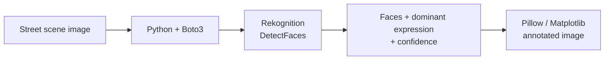

# AI Image Analysis: Face & Emotion Detection with Amazon Rekognition

-232F3E?style=flat-square)

A computer vision script that finds every face in an image, reads its predicted expression, and draws labeled bounding boxes with confidence scores right onto the image.

📄 **Full case study:** [AI Image Analysis: Emotion & Object Detection](https://iamnicolecoleman.com/portfolio/case-study-ai-powered-image-analysis-for-emotion-and-object-detection/)

  

## Skills demonstrated

| Skill | Where it shows up |
|---|---|
| Cloud AI services | Amazon Rekognition face analysis API (`DetectFaces`) |
| API integration | Python and Boto3 to call Rekognition, read the image from S3, and parse the JSON response |
| Computer vision output handling | Converting Rekognition's relative bounding boxes into pixel coordinates |
| Visualization | Drawing boxes, labels, and confidence scores with Pillow and Matplotlib |
| Solution framing | Mapping the output to use cases like event engagement and customer experience research |

## How it works

1. **Detect:** Rekognition's facial analysis returns each face's location and its predicted expressions (such as happy, surprised, or angry), each with a confidence score.
2. **Pick:** the script keeps the highest-confidence expression for each face.
3. **Visualize:** it converts Rekognition's relative bounding boxes to pixels and draws the box and label on the original image, so results are readable at a glance instead of buried in JSON.

## Files

| File | Description |
|---|---|
| `detect_faces_emotions.py` | Detects faces with Rekognition, picks each face's highest-confidence expression, and draws labeled bounding boxes |

**Run it:** `pip install boto3 pillow matplotlib`, configure AWS credentials, set `BUCKET` and `PHOTO`, then `python detect_faces_emotions.py`.

## Where this applies

- **Events:** gauging audience reactions across photos
- **Customer experience research:** reviewing reactions in product or usability testing
- **Operations:** turning batches of images into structured, searchable data

> Note: expression labels describe how a face looks, not how a person actually feels. They're a signal to review, not a conclusion.

## What I learned

- Clear visualization is what makes AI output usable for non-technical people
- Managed cloud AI services let a small team ship computer vision without training a model
- The value is in pairing the technical output with a specific business question

---

**Nicole Coleman** · AWS Community Builder (AI Engineering) · [LinkedIn](https://www.linkedin.com/in/nicoledcoleman/) · [Portfolio](https://iamnicolecoleman.com)
