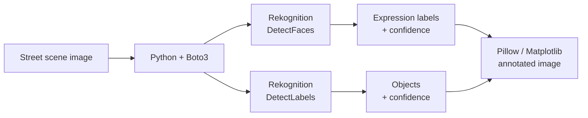

# AI Image Analysis: Emotion & Object Detection with Amazon Rekognition

-232F3E?style=flat-square)

A computer vision pipeline that takes a busy street scene and returns what's in it: every face with its predicted expression, every object with a label, and confidence scores drawn right onto the image.

📄 **Full case study:** [AI Image Analysis: Emotion & Object Detection](https://iamnicolecoleman.com/portfolio/case-study-ai-powered-image-analysis-for-emotion-and-object-detection/)

  

## Skills demonstrated

| Skill | Where it shows up |
|---|---|
| Cloud AI services | Amazon Rekognition face analysis and label detection APIs |
| API integration | Python and Boto3 to send images and parse the JSON responses |
| Computer vision output handling | Converting Rekognition's relative bounding boxes into pixel coordinates |
| Visualization | Drawing boxes, labels, and confidence scores with Pillow and Matplotlib |
| Solution framing | Mapping the output to use cases like retail analytics, event engagement, and crowd management |

## How it works

1. **Faces:** Rekognition's facial analysis returns each face's location and predicted expressions (such as happy, surprised, or angry) with a confidence score.
2. **Objects:** label detection finds people, handbags, clothing, and other objects in crowded, fast-moving scenes.
3. **Visualization:** the script draws bounding boxes and labels on the original image so the results are readable at a glance, not buried in JSON.

## Where this applies

- **Retail:** what shoppers carry and how they move through a space
- **Events:** engagement and crowd density
- **Operations:** turning large batches of images into structured, searchable data

> Note: expression labels describe how a face looks, not how a person actually feels. They're a signal to review, not a conclusion.

## What I learned

- Clear visualization is what makes AI output usable for non-technical people
- Managed cloud AI services let a small team ship computer vision without training a model
- The value is in pairing the technical output with a specific business question

---

**Nicole Coleman** · AWS Community Builder (AI Engineering) · [LinkedIn](https://www.linkedin.com/in/nicoledcoleman/) · [Portfolio](https://iamnicolecoleman.com)
